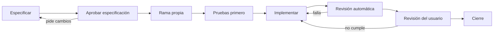

# Plan – App de Gastos Personales

Nov 14, 2026 · @Giovanni

## 1. Resumen y alcance

App web (PWA) para registrar gastos mensuales que se descuentan de un presupuesto por período, con ingresos, bolsas de dinero (Efectivo, Nequi, Daviplata), gastos periódicos con confirmación, préstamos realizados y deudas. Uso principal en el móvil, para un solo usuario inicialmente, con autenticación, en pesos colombianos (COP) y en español (por defecto) e inglés.

**Incluido en el MVP**

- Autenticación con email y contraseña, sin registro: un solo usuario creado a mano en Supabase y registros desactivados. Todas las pantallas requieren sesión, excepto el inicio de sesión y la recuperación de contraseña por correo (`/recuperar` y `/nueva-contrasena`, decidida en la Etapa 4).
- Período configurable (día de inicio fijo) con presupuesto propio, independiente de los ingresos.
- Gastos, ingresos, bolsas y ajustes de saldo.
- Gastos periódicos con confirmación, pausa y fin indefinido o por número de repeticiones.
- Préstamos realizados y deudas (incluidas compras con tarjeta de crédito) con control de cuotas.
- Gestión con CRUD de categorías (con subcategoría opcional), formas de pago, bolsas, lugares y personas/entidades.
- Lectura del QR de factura electrónica DIAN desde una foto (la foto no se guarda).
- Filtros, panel, reportes con gráficas, exportación a Excel (lo filtrado) y PDF (las gráficas).
- Alertas push desde el 70 % del presupuesto en incrementos de 5 %; recordatorios de periódicos y cuotas.

**Fuera del MVP (fases futuras)**

- Lectura de recibos con IA.
- Notificaciones por correo.
- Modo oscuro (el diseño queda preparado desde el inicio).
- Multiusuario abierto al público.

## 2. Stack definido

React como web + PWA, Supabase como backend (segundo proyecto, separado del existente), Netlify para publicar y GitHub para el código.

| Capa | Elección | Motivo |
| --- | --- | --- |
| Frontend | React 19 + TypeScript, PWA instalable (versiones en CLAUDE.md) | Uso principal en el móvil sin tiendas de apps |
| Estilos y componentes | Tailwind CSS 4 + shadcn/ui | Componentes accesibles, fácil de ajustar al design.md |
| Íconos | Lucide (SVG) | Biblioteca SVG para categorías y la interfaz |
| Gráficas | Charts de shadcn/ui (sobre Recharts), decidido el 15-nov-2026 | Mismos tokens y componentes que el resto de la UI |
| Rutas | React Router 8 en modo librería, decidido el 15-nov-2026 | Layout común anidado, carga diferida por pantalla y rutas protegidas |
| Organización de componentes | Híbrida inspirada en diseño atómico: `components/ui` (shadcn), `components/shared`, `features/<módulo>/components`, `routes/` | Compone de lo pequeño a lo grande sin discutir niveles |
| Idiomas | Español (por defecto) e inglés | Textos en archivos de traducción desde el inicio |
| Backend | Supabase: PostgreSQL, Auth, Edge Functions, tareas programadas | Login, API y seguridad incluidos; capa gratuita de 500 MB por proyecto |
| Seguridad de datos | Reglas por fila (RLS) | Cada usuario solo ve lo suyo |
| Lectura de QR | Librería de lectura de QR en el navegador | Lee el QR de la factura DIAN desde la cámara o la galería |
| Exportación | Generación de Excel y PDF en la app | Excel con lo filtrado, PDF con las gráficas |
| Notificaciones | Web Push de la PWA | En iPhone solo con la app instalada en la pantalla de inicio |
| Publicación | Netlify, con versiones de prueba por cada cambio | Cada etapa se revisa en un enlace propio antes de aprobarla |
| Código | Repositorio en GitHub + GitHub Actions + GitHub Projects | Pruebas automáticas y tablero Kanban |
| Desarrollo | Claude Code | Implementa cada etapa con pruebas y revisión |

El proyecto actual de Supabase no se toca: el nuevo proyecto tiene su propia base de datos y sus usuarios. Todo el desarrollo y las pruebas se hacen con Supabase local; el proyecto real solo recibe cambios ya aprobados.

## 3. Reglas de negocio

El presupuesto del período es la referencia: los gastos lo descuentan, los ingresos con destino “presupuesto” lo aumentan, y las bolsas solo mueven saldos.

### 3.1 Período y presupuesto

- El período va del día 1 al fin de mes por defecto. El usuario puede fijar otro día de inicio (por ejemplo, del 15 al 14) y se mantiene hasta que lo cambie.
- Si el día de inicio no existe en un mes (por ejemplo, el 31), el período empieza el último día de ese mes. Al cambiar el día de inicio, el período en curso no se toca y un período de transición cubre los días hasta el nuevo inicio (decidido en la Etapa 3, 20-nov-2026).
- Cada período nace con el presupuesto por defecto, que se puede ajustar en ese período.
- El presupuesto es independiente de los ingresos. Un ingreso con destino “presupuesto” aumenta el disponible del período.
- Saldo disponible = presupuesto + ingresos con destino presupuesto − gastos que afectan el presupuesto − aportes de ahorro que afectan el presupuesto. Un cobro de préstamo con destino presupuesto cuenta como ingreso del período en que llega.
- El sobrante no se acumula ni se pierde: queda como estadística del período cerrado.
- Al cerrar un período se guarda un resumen: presupuesto, ingresos, gastado, saldo, gasto por categoría, préstamos pendientes por cobrar y cuotas de deudas pendientes.

### 3.2 Alertas de presupuesto

- Notificación push al alcanzar el 70 %, 75 %, 80 %, 85 %, 90 %, 95 % y 100 % del presupuesto, y al superarlo.
- Cada umbral se avisa una sola vez por período.
- Si un gasto cruza varios umbrales a la vez, todos quedan registrados, pero se envía **un solo push** con el más alto (el envío llega en la Etapa 12). Un umbral avisado no se vuelve a avisar aunque el porcentaje baje (por ejemplo, al subir el presupuesto). Con presupuesto 0 no hay alertas (decidido el 20-nov-2026).
- En pantalla, la barra y los avisos usan un degradado de amarillo a rojo del 70 % al 100 % (un token por umbral, `DESIGN.md`).

### 3.3 Gastos

- Campos: título, fecha, valor, lugar, origen del pago, canal (opcional), descripción u observaciones, categoría y subcategoría (opcional).
- **Origen del pago:** una bolsa (Efectivo, Nequi, Daviplata) o un medio directo (Débito, Crédito, Transferencia).
- **Canal (opcional):** Bre-B. Ejemplo: “Origen: Nequi · Canal: Bre-B” descuenta de la bolsa de Nequi.
- Al registrar un gasto solo se muestran categorías de tipo gasto; las de préstamos y deudas no aparecen.
- Una compra con tarjeta de crédito siempre se registra como deuda, aunque sea a una sola cuota (ver 3.8).

### 3.4 Bolsas (Efectivo, Nequi, Daviplata)

- Una bolsa por medio, con saldo propio. Se pueden crear más (por ejemplo, “Efectivo viaje”).
- Las bolsas aparecen como origen al registrar un gasto, mostrando su saldo (“Efectivo · quedan $35.000”).
- **Recarga** (retiro de cajero, recarga de Nequi): suma al saldo de la bolsa y no afecta el presupuesto. Sin comisión de cajero.
- Los gastos con origen en una bolsa descuentan de la bolsa y del presupuesto en el momento de registrarse.
- El saldo de la bolsa pasa al siguiente período.
- **Ajustar saldo:** si el saldo real es menor que el de la app, la diferencia se registra como gasto de categoría *Gasto desconocido*; si es mayor, como movimiento de ajuste que suma a la bolsa sin afectar el presupuesto. Todo ajuste queda registrado con el saldo contado, la fecha y una nota (decidido el 18-nov-2026).
- **Saldo negativo:** la app advierte y permite el gasto.

### 3.5 Ingresos

- Campos: título, fecha, valor, descripción, categoría de ingreso y **destino** (una bolsa o el presupuesto); el valor se suma al destino.
- El dinero recibido por un préstamo se registra como *Ingreso por préstamo*, con su destino, y no cuenta en las estadísticas de ingresos.

### 3.6 Gastos periódicos

- Frecuencias: diaria, semanal, quincenal, mensual, bimestral, trimestral, anual o cada N días/semanas/meses.
- Duración indefinida o por número de repeticiones.
- Al llegar la fecha se crea un gasto **pendiente de confirmar**, con notificación push; al confirmarlo se puede ajustar el valor.
- Cambiar la regla aplica desde ese momento en adelante; el historial no cambia.
- Se puede pausar y reanudar.
- Casos especiales: día 31 en meses cortos (último día del mes), años bisiestos y fechas atrasadas sin duplicar gastos.
- Quincenal: los días D y D+15 de cada mes (o D−15 y D si D+15 pasa de 31). Mientras una regla está pausada no se generan los pendientes de ese tramo. La primera fecha la calcula la base de datos al crear la regla (Etapa 3, 20-nov-2026).

### 3.7 Préstamos que hago

- Sección propia “Préstamos”, con atajo “Es un préstamo” desde el formulario de gasto.
- Campos: persona (sin duplicados, gestionada con CRUD), monto, fecha, origen, nota opcional y fecha acordada de pago opcional con recordatorio push.
- Prestar **descuenta del presupuesto** y del origen.
- El préstamo sigue abierto entre períodos y aparece en el cierre como pendiente por cobrar.
- **Registrar pago:** pagos parciales hasta saldarlo; cada pago es un ingreso de categoría *Cobro de préstamo* con el destino elegido (bolsa o presupuesto), en el período en que llega.
- Estados: Pendiente → Parcial → Pagado, o **No recuperado**: solo cambia el estado y cuenta como pérdida en estadísticas, sin volver a descontar.

### 3.8 Deudas (lo que debo)

- Sección propia “Deudas”. Incluye préstamos de bancos o personas y compras con tarjeta de crédito (a 1 o más cuotas).
- Campos: entidad o persona, total a pagar, número de cuotas, valor de la cuota (fija por defecto), día de pago, origen y canal de pago, y si la cuota **afecta o no el presupuesto** (por ejemplo, una cuota por nómina no lo afecta).
- La app calcula el saldo pendiente (total a pagar − cuotas pagadas − abonos) y la fecha estimada de la última cuota. **Sin control de intereses** (decidido el 18-nov-2026): no se guarda el valor recibido.
- **Solo la cuota pagada en el período** afecta el presupuesto; las cuotas futuras son estadística y proyección.
- Cada cuota llega como pendiente de confirmar, con recordatorio push, y su valor se puede ajustar al confirmar.
- **Abono extraordinario:** se registra y luego se edita el plan (cuotas, valor o fechas) según el acuerdo con el acreedor.
- Las cuotas usan la categoría *Pago de préstamos*. Cada tarjeta de crédito tiene su propia categoría (por ejemplo, “Compra Tarjeta de Crédito Visa Banco X”), creada automáticamente al registrar la tarjeta, con ícono de tarjeta y color editable.
- Las tarjetas se registran solo con un nombre descriptivo: nunca números, fechas de vencimiento ni códigos de seguridad.
- Estados: Activa → Pagada.
- El plan de cuotas lo crea la base de datos (`generar_plan_cuotas`, y la tarea diaria si falta): la primera cuota cae en el primer día de pago después de la fecha de la deuda y la última toma la diferencia para cuadrar el total (Etapa 3, 20-nov-2026).

### 3.9 Lugares

- Lista gestionada con CRUD que también se llena con lo que se escribe, sin NIT (hay gastos sin factura).
- Nombres normalizados sin mayúsculas, tildes ni espacios extra: “Exito”, “éxito” y “EXITO” son el mismo lugar.
- Autocompletado al escribir y sugerencia de nombres parecidos.

### 3.10 Lectura del QR de factura

- Se toma una foto o se elige de la galería; se lee el QR de la factura electrónica DIAN y la foto se descarta.
- El QR llena la fecha y el valor; el usuario elige o crea el lugar y completa el resto.
- Si la factura no tiene QR, el gasto se registra a mano. La lectura con IA queda para más adelante.

### 3.11 Categorías

- Modelo: ícono (SVG de Lucide), nombre, color y tipo (gasto, ingreso, préstamo, deuda).
- Cada formulario muestra solo las categorías de su tipo.
- Subcategorías opcionales; heredan ícono y color de su categoría.
- Predefinidas de gasto: Alimentación, Transporte, Hogar, Servicios públicos, Salud, Educación, Entretenimiento, Ropa, Suscripciones, Mascotas, Otros y Gasto desconocido.
- Del sistema: Ingreso por préstamo, Préstamo realizado, Cobro de préstamo, Préstamo no recuperado y Pago de préstamos.
- Borrar una categoría muestra una advertencia; los gastos conservan el nombre, ícono y color con que se registraron.

### 3.12 Formas de pago

- Gestionadas con CRUD. Iniciales: Efectivo, Débito, Crédito, Transferencia, Nequi, Daviplata y Bre-B.
- Efectivo, Nequi y Daviplata son bolsas con saldo; Bre-B es un canal.

### 3.13 Filtros, reportes y exportación

- Filtros: período (este período, anterior, últimos 3, este año, rango personalizado), categoría, forma de pago, lugar, rango de monto y búsqueda en título u observaciones.
- Gráficas según el dato: proporción por categoría, comparación entre períodos y gasto acumulado contra presupuesto.
- Excel con los gastos filtrados; PDF con las gráficas.

### 3.14 Gestión de datos (CRUD)

- No hay listas fijas: categorías de gasto e ingreso, subcategorías, formas de pago, bolsas, lugares y personas o entidades se gestionan con CRUD (crear, consultar, editar, eliminar).
- Los valores iniciales (categorías predefinidas, formas de pago y categorías de ingreso Salario, Extra, Venta, Otros) son solo datos de arranque: se pueden editar o eliminar.
- Excepción: las categorías del sistema (Gasto desconocido, Ingreso por préstamo, Préstamo realizado, Cobro de préstamo, Préstamo no recuperado, Pago de préstamos) se pueden renombrar y cambiar de ícono y color, pero no eliminar, porque bolsas, préstamos y deudas dependen de ellas.
- Eliminar un registro en uso muestra una advertencia y conserva el historial.
- Lugares y personas también se crean al escribirlos en un formulario; desde su CRUD se pueden renombrar, unir duplicados o eliminar.

### 3.15 Ahorros (metas)

Módulo agregado en la Etapa 1 (18-nov-2026), a partir del diseño aprobado. Sus reglas se confirman en la especificación de la Etapa 6.

- Una **meta** tiene nombre, monto a alcanzar, fecha final y saldo inicial opcional. Cada meta tiene **su propia bolsa**.
- **Aporte:** pasa dinero de una bolsa o medio a la bolsa de la meta. No es gasto y no baja el disponible del período.
- **Aportes periódicos** (semanal, quincenal o mensual, con día y origen): llegan como **pendientes de confirmar**. Al confirmarlos se puede ajustar el valor, solo esta vez o en adelante. También se puede **omitir** uno; la fecha final no cambia y el aporte sugerido sube.
- **Retirar:** saca dinero de la meta hacia una bolsa, con motivo.
- **Pausar y reanudar:** detiene los aportes periódicos; lo ahorrado se queda en la meta.
- **Eliminar:** pide a qué bolsa pasa lo ahorrado; el historial se conserva.
- **Estados** derivados: al día, atrasada (por debajo del ritmo ideal), cumplida y pausada. El detalle muestra la proyección ("a este ritmo la cumples en …").
- **Aporte desde un medio directo** (Débito, Transferencia): se elige en cada aporte y en la regla, con la casilla "afecta el presupuesto". Si afecta, baja el disponible del período pero no cuenta como gasto en las estadísticas. Un aporte desde una bolsa nunca afecta el presupuesto (decidido el 18-nov-2026).
- No se generan aportes después de la fecha final ni con la meta pausada. Estado, ritmo ideal, aporte sugerido y proyección los calcula `estado_metas(hoy)` en la base de datos (Etapa 3, 20-nov-2026).

## 4. Modelo de datos

Todas las entidades pertenecen a un usuario; los montos se guardan en pesos enteros (COP sin decimales) y los saldos y totales se calculan a partir de los movimientos.

| Entidad | Campos principales | Relaciones |
| --- | --- | --- |
| Perfil | nombre, idioma, día de inicio del período, presupuesto por defecto | 1 usuario |
| Período | fecha de inicio, fecha de fin, presupuesto, estado (abierto/cerrado), resumen al cierre | Tiene gastos, ingresos y alertas |
| Categoría | nombre, ícono, color, tipo (gasto/ingreso/préstamo/deuda), del sistema sí/no, categoría padre (opcional), archivada | Una subcategoría apunta a su padre |
| Forma de pago | nombre, clase (bolsa/medio directo/canal), activa | Una bolsa tiene saldo |
| Bolsa | nombre, forma de pago asociada | Recibe recargas, ingresos y ajustes; descuenta gastos |
| Movimiento de bolsa | tipo (recarga/ajuste/saldo inicial/aporte/retiro), sentido (entrada/salida), fecha, valor, saldo contado (solo ajustes), afecta presupuesto (solo aportes desde un medio directo), estado (pendiente/confirmado/omitido, en aportes de una regla) | Pertenece a una bolsa; meta, medio directo y regla de aporte opcionales. Gastos e ingresos no se copian aquí: apuntan a la bolsa desde su tabla |
| Meta de ahorro | nombre, monto a alcanzar, fecha final, pausada sí/no, eliminada (fecha); los estados al día, atrasada y cumplida se derivan | Tiene su propia bolsa; regla de aporte periódico (opcional) |
| Regla de aporte | valor, frecuencia, día, origen, afecta presupuesto (solo medio directo), próxima fecha, activa/pausada | Genera aportes pendientes de confirmar |
| Lugar | nombre visible, nombre normalizado (único) | Lo usan los gastos |
| Persona o entidad | nombre visible, nombre normalizado (único), tipo (persona/banco/tarjeta) | La usan préstamos y deudas |
| Gasto | título, fecha, valor, descripción, estado (confirmado/pendiente), afecta presupuesto sí/no, es ajuste sí/no con saldo contado, copia de nombre/ícono/color de la categoría | Período (deducido de la fecha), categoría y subcategoría, lugar, origen (bolsa o medio), canal, regla periódica, préstamo o cuota de deuda (opcionales) |
| Ingreso | título, fecha, valor, descripción, destino (bolsa o presupuesto), cuenta en estadísticas sí/no, copia de la categoría | Período (deducido de la fecha), categoría de ingreso, préstamo o deuda (opcional) |
| Regla periódica | plantilla del gasto, frecuencia, intervalo, día, inicio, repeticiones o indefinida, próxima fecha, activa/pausada | Genera gastos pendientes |
| Préstamo realizado | monto, fecha, nota, fecha acordada (opcional), no recuperado sí/no (los demás estados se derivan) | Persona, gasto de salida, ingresos de cobro |
| Deuda | fecha, total a pagar, cuotas, valor de cuota, día de pago, afecta presupuesto sí/no (estado derivado; sin intereses) | Persona o entidad, categoría (tarjeta o pago de préstamos), origen y canal |
| Cuota de deuda | número, fecha, valor, estado (pendiente/pagada) | Deuda; al pagarse genera un gasto |
| Abono extraordinario | fecha, valor, nota | Deuda |
| Alerta enviada | umbral (70–100 % o más), fecha | Período; evita repetir avisos |
| Suscripción push | dispositivo, datos de suscripción | Usuario |

Criterios del modelo: la regla periódica y la deuda son plantillas que generan gastos reales, así el historial no cambia al editarlas. Los saldos (presupuesto, bolsas, deudas, préstamos) se derivan de los movimientos, nunca se escriben a mano.

## 5. Metodología y forma de trabajo

Cada etapa se desarrolla con tres métodos combinados y no se pasa a la siguiente sin un cierre aprobado por el usuario.

| Nivel | Método | Cómo se aplica |
| --- | --- | --- |
| Cada etapa | Desarrollo guiado por especificación (SDD) | Antes de programar se escribe una especificación corta: qué hace, reglas y criterios de aceptación. El usuario la aprueba; luego se divide en tareas y se implementa |
| Reglas de cálculo | Pruebas primero (TDD) | Para períodos, periódicos, alertas, bolsas, préstamos, deudas y normalización de nombres se escriben primero las pruebas y después el código |
| Seguimiento | Kanban en GitHub Projects | Columnas: Por hacer → Especificando → En desarrollo → En revisión → Cerrado |

### Ciclo de cada etapa

1. **Especificar:** un *issue* en GitHub con objetivo, entregables y criterios de aceptación en lista.
2. **Aprobar la especificación:** el usuario la revisa y la aprueba o pide cambios.
3. **Rama propia** para la etapa.
4. **Pruebas primero** para las reglas de cálculo.
5. **Implementar** con Claude Code siguiendo CLAUDE.md.
6. **Revisión automática:** pruebas en GitHub Actions y revisión de código y seguridad. Si algo falla, vuelve a implementar.
7. **Revisión del usuario** en la versión de prueba de Netlify, desde el móvil, con la lista de criterios. Si algo no cumple, vuelve a implementar.
8. **Cierre de la etapa.**

Si las pruebas fallan o la revisión no cumple, la etapa vuelve a implementación; solo con tu aprobación llega al cierre.

### Cierre de cada etapa

Una etapa se da por terminada solo cuando:

- [ ] Cumple todos sus criterios de aceptación.
- [ ] Pasa todas las pruebas automáticas y la revisión de código, sin errores pendientes.
- [ ] El usuario revisó la versión de prueba en móvil (navegador e instalada), tablet y computador, y la aprobó.
- [ ] Se entregó un resumen escrito: qué se hizo, qué quedó pendiente y qué se decidió.
- [ ] Se fusionó a la rama principal y se marcó la versión en GitHub (por ejemplo, “etapa-3”).
- [ ] Se actualizó este documento y la especificación de la siguiente etapa.

## 6. Harness de pruebas y revisión

El harness se monta en la Etapa 0 y crece con cada etapa: ningún cambio llega a la rama principal sin pasar todas sus capas.

### Capas de prueba

| Capa | Qué comprueba | Cuándo corre |
| --- | --- | --- |
| Calidad estática | Tipos, reglas de estilo y formato | En cada cambio |
| Reglas de cálculo (pgTAP en SQL desde la Etapa 3; unitarias para lo de presentación) | Fechas del período (15 al 14), próximas fechas de periódicos (día 31, bisiestos), umbrales de alerta, saldos de bolsas, cuotas, normalización de nombres, lectura de QR con facturas de ejemplo | En cada cambio |
| Base de datos | Que un usuario no vea datos de otro (RLS), que borrar una categoría conserve el historial, que no se dupliquen gastos periódicos | En cada cambio, contra Supabase local |
| Componentes | Formularios, validaciones, filtros, categorías por tipo | En cada cambio |
| Recorridos completos (E2E) | Flujos reales en los tres tamaños (móvil, tablet, computador); por ejemplo: crear un periódico → avanzar la fecha → confirmarlo → ver el descuento en presupuesto y bolsa; y que sin sesión toda ruta redirija al login | En cada solicitud de cambio |
| Accesibilidad e idiomas | Contraste de colores, íconos con etiqueta, textos traducidos en español e inglés | En cada solicitud de cambio |

### Tamaños y modos de uso

La app es un solo código con diseño adaptable: se prueba en tres tamaños y en dos modos. Móvil web y móvil PWA tienen el mismo tamaño; cambia el modo.

| Tamaño | Distribución esperada | Modos a probar |
| --- | --- | --- |
| Móvil | Una columna, navegación inferior, botón flotante, gastos en tarjetas | Navegador e instalada (PWA) |
| Tablet | Dos columnas (lista y detalle), menú lateral plegable, botones del tamaño de un dedo | Navegador e instalada |
| Computador | Menú lateral fijo, panel con varias gráficas, gastos en tabla, filtros visibles, uso con mouse y teclado | Navegador e instalada |

**Pruebas propias de la PWA (modo instalada)**

- La app se puede instalar en móvil y computador.
- En pantalla completa nada queda tapado por la muesca o la barra del sistema.
- Al publicar una versión nueva, la app instalada se actualiza.
- Las notificaciones push llegan (en iPhone y iPad, solo con la app instalada).
- Sin conexión se muestra un aviso claro.
- Si la app está abierta en dos dispositivos, un gasto registrado en uno aparece en el otro.

### Reglas del harness

- Las pruebas que dependen de fechas usan un reloj fijo, para que el resultado no cambie según el día.
- Datos de prueba propios (semillas) y facturas de ejemplo para el QR; nunca datos reales.
- Todo corre contra Supabase local; el proyecto real solo recibe migraciones aprobadas.
- GitHub Actions bloquea la fusión si alguna capa falla.
- Netlify publica una versión de prueba por cada solicitud de cambio.

### Trabajo con Claude Code

- **CLAUDE.md** en el repositorio con: reglas de negocio de este documento, convenciones de código, cómo correr las pruebas y la definición de cierre.
- Por cada etapa, Claude Code lee la especificación aprobada, escribe primero las pruebas de las reglas, implementa, corre todo el harness y ejecuta una revisión de código y de seguridad antes de entregar.
- Entrega por etapa: solicitud de cambio en GitHub, enlace a la versión de prueba y resumen escrito.
- Claude Code no fusiona ni publica en producción sin la aprobación del usuario.

## 7. Etapas del proyecto

Trece etapas en orden; cada una termina con el cierre de la sección 5 y su propio criterio principal. Toda etapa con pantallas debe cumplir en los tres tamaños (móvil, tablet, computador) y en ambos modos (navegador e instalada).

| Etapa | Objetivo | Entregables | Criterio principal de cierre |
| --- | --- | --- | --- |
| 0. Preparación | Dejar listo el entorno y el harness | Repositorio en GitHub, tablero Kanban, segundo proyecto Supabase, Supabase local, Netlify con versiones de prueba, GitHub Actions, CLAUDE.md | Una página vacía publicada en Netlify y el harness corriendo en GitHub |
| 1. Diseño de plantillas y pantallas | Definir cómo se ve y se usa la app antes de programarla | Inventario de pantallas y flujos, bocetos en tres tamaños (móvil, tablet, computador) hechos en Claude Design a partir de los ejemplos de Stitch, DESIGN.md (colores, tipografía, espaciado, componentes y estados, íconos, preparado para modo oscuro), elección de la librería de gráficas | El usuario aprueba todas las pantallas y el design.md |
| 2. Base de datos y seguridad | Crear el modelo de datos | Tablas, relaciones, reglas RLS, categorías y formas de pago iniciales | Pruebas de RLS y de historial al borrar categorías en verde |
| 3. Lógica del servidor | Reglas que no dependen de pantallas | Cálculo de períodos, generación de periódicos y cuotas, alertas, saldos de bolsas, resumen de cierre, tarea programada diaria | Todas las pruebas de reglas de cálculo en verde |
| 4. Base del frontend | Estructura común de la app | Login (sin registro) y recuperación de contraseña por correo, rutas protegidas con layout común, diseño adaptable a tres tamaños (navegación inferior en móvil, menú lateral en tablet y computador), español e inglés, PWA instalable, componentes del design.md | La app se instala en móvil y computador, y el login funciona en los tres tamaños; sin sesión, toda ruta redirige al login |
| 5. Gestión de datos (CRUD) | Datos de referencia | Categorías con subcategorías y tipos, formas de pago (medios y canales), lugares, personas o entidades | Sin duplicados en lugares y personas; categorías filtradas por tipo |
| 6. Presupuesto, ingresos y bolsas | Controlar el dinero disponible | Configuración del período, presupuesto, ingresos con destino, bolsas (crear, renombrar, eliminar, decidido en la Etapa 5), recargas y ajuste de saldo, metas de ahorro con aportes y retiros (3.15) | Saldos de presupuesto y bolsas correctos en los recorridos E2E |
| 7. Gastos y filtros | Registrar y consultar gastos | Formulario de gasto, lista agrupada por día, todos los filtros y búsqueda | Un gasto descuenta del presupuesto y de su bolsa; los filtros devuelven lo esperado |
| 8. Gastos periódicos | Automatizar gastos repetidos | Reglas, pendientes por confirmar, pausa, edición hacia adelante | Recorrido completo crear → generar → confirmar en verde |
| 9. Préstamos y deudas | Controlar dinero prestado y debido | Sección Préstamos (cobros parciales, no recuperado) y sección Deudas (cuotas, tarjetas, abonos, proyección) | Solo la cuota pagada afecta el presupuesto; los pendientes aparecen en el cierre |
| 10. Lectura de QR | Registrar gastos desde la factura | Cámara o galería (en computador, subir la foto), lectura del QR DIAN, formulario prellenado | Facturas de ejemplo llenan fecha y valor correctamente |
| 11. Panel, reportes y exportación | Analizar el gasto | Panel principal, gráficas, comparación entre períodos, Excel con lo filtrado, PDF con las gráficas | Totales de gráficas y archivos coinciden con los datos |
| 12. Notificaciones y publicación | Avisos y salida a producción | Push de alertas, periódicos y cuotas; migraciones al proyecto real; dominio; copias de seguridad | La app en producción envía las alertas del 70 % en adelante |

Las mejoras futuras (IA para recibos, correo, modo oscuro) se planifican como etapas nuevas con el mismo ciclo.

### Registro de cierres

| Etapa | Cierre | Especificación y PR | Decisiones |
| --- | --- | --- | --- |
| 0. Preparación | 15-nov-2026 | #4 · PR #5 | Repo público para que el ruleset de `main` exija los checks `estatica`, `unitarias`, `base-de-datos` y `e2e`, con GitHub Free. Cada dependencia entra en la etapa que la usa. i18n desde el día uno. Netlify publica producción desde `main` (sitio `app-gastos-gah`) y una versión de prueba por PR. Supabase local con registros desactivados y prueba pgTAP de guardia de RLS. Tablero de GitHub Projects con un issue por etapa (#6 a #17); la especificación de cada etapa se escribe en su issue. Para ahorrar créditos de Netlify, la versión de prueba se pide con `[preview]` en el commit y solo se construye si cambió la app (`scripts/netlify-ignore.sh`). |
| 1. Diseño de plantillas y pantallas | 18-nov-2026 | #6 · PR #20 y PR de cierre | Pantallas diseñadas en Claude Design ([lienzo](https://claude.ai/artifact/NQYDHYjenHaJBrSg7o6skm), 16 secciones en tres tamaños con modales y estados). Sistema de diseño en [App-Gastos Design System](https://claude.ai/artifact/KeLyaiHYpr9p7wyvstXyfJ) y resumen en PDF. `DESIGN.md` reemplaza a `diseno-ui/references/tokens.md` (misma paleta, ahora con `destructive-soft`, `warning-soft`, `warning-ink`, `chart-budget`, colores iniciales de categoría, medidas y sombras). Nuevo módulo **Ahorros** (3.15, Etapa 6). Cada sección del lienzo se implementa como una tarea propia, en la etapa que indica `DESIGN.md` §9. Gráficas con charts de shadcn sobre Recharts. Etapa sin código ni versión de prueba de Netlify. |
| 2. Base de datos y seguridad | 18-nov-2026 | #7 · PR #22 y PR de cierre | 19 tablas en Supabase local con RLS (cuatro políticas cada una) y llaves compuestas `(x_id, user_id)` contra referencias a datos de otro usuario; 200 pruebas pgTAP. El período de gastos e ingresos se deduce de la fecha. `movimientos_bolsa` solo guarda recargas, ajustes, saldos iniciales, aportes y retiros. Gastos e ingresos copian nombre, ícono y color de la categoría; lo que está en uso se archiva y no se borra. Categorías del sistema con `clave_sistema`, protegidas por trigger. `inicializar_usuario` idempotente con trigger en `auth.users` (en la Etapa 12 se llama a mano para el usuario real). Decisiones de Giovanni: aportes desde medio directo eligen si afectan el presupuesto, ajustes registrados con saldo contado, deudas sin intereses, categorías de ingreso iniciales. `supabase db lint` en el CI. Sin cambios en `src/` ni versión de prueba de Netlify. |
| 3. Lógica del servidor | 20-nov-2026 | #8 · PR #24 y PR de cierre | Las reglas de cálculo viven en SQL (funciones y vistas en Supabase), probadas con pgTAP; `src/dominio/` queda para lo de presentación. 9 migraciones y 383 pruebas pgTAP. Funciones con `p_hoy` (por defecto `hoy_bogota()`) como reloj inyectable; vistas con `security_invoker`; las funciones internas no se exponen por la API y las de la app solo a `authenticated`. Errores con códigos (`P0001`/`P0002` y una clave) en lugar de textos. Tarea diaria con pg_cron a las 00:10 de Bogotá (idempotente, se pone al día si dejó de correr) y `ponerse_al_dia()` al abrir la app. Plan de cuotas por RPC (`generar_plan_cuotas`) en vez de trigger, para no romper el historial de la Etapa 2. Decisiones de Giovanni: reglas en la base de datos; alertas con un solo push del umbral más alto y sin rearmar; degradado amarillo→rojo de 70 a 100 en `DESIGN.md`. Pendiente para las Etapas 6 y 8: editar frecuencia, día o inicio de una regla no recalcula la próxima fecha. Sin cambios en `src/` ni versión de prueba de Netlify. |
| 4. Base del frontend | 25-nov-2026 | #9 · PR #26 | Rutas públicas: `/login`, `/recuperar` y `/nueva-contrasena` (recuperación por correo, decisión de Giovanni); sesión con `flowType: "implicit"` y retorno con `?siguiente=` solo a rutas internas. Layout en tres tamaños (barra inferior, menú lateral de 72 px con tooltips y de 256 px), «Más», Ajustes (idioma guardado en el dispositivo, cuenta, versión desde `package.json`, cerrar sesión con confirmación y `scope: "local"`, que funciona sin red), En construcción y No encontrada. Franja sin conexión sin cola de cambios; aviso de versión nueva con `clientsClaim`. PWA instalable con íconos propios. Átomos de shadcn copiados a mano (el CLI no llega desde la nube); sin `DropdownMenu` (entra en la Etapa 5). Registrar abre `/gastos/nuevo`. E2E con Supabase local y Mailpit; tipos generados revisados en el CI; tablet en Playwright con iPad Pro 11 a 820×1180. Variables de Supabase en Netlify y URLs de redirección y mínimo de 8 caracteres en Supabase Auth. La plantilla del correo en español (`supabase/templates/recuperar.html`) solo se aplica en local: el proyecto real pide SMTP propio, que queda para la etapa que lo especifique. `ponerse_al_dia()`, react-query, react-hook-form y zod pasan a las Etapas 5 y 6. |
| 5. Gestión de datos (CRUD) | 25-nov-2026 | #10 · PR #27 | Pantallas Categorías (`/categorias`, pestañas por tipo en `?tipo=`) y Formas de pago, lugares y personas (`/listas`, pestañas en `?lista=`) en tres tamaños. Eliminar borra si no hay uso y archiva si lo hay; una categoría principal arrastra sus subcategorías. Crear un lugar o persona con el nombre de uno archivado lo reactiva. Unir solo entre el mismo tipo o clase, por RPC en una transacción. Posibles duplicados con `pg_trgm` (similitud ≥ 0,5 o nombre contenido) y tabla `pares_distintos` para «No son el mismo». Vistas `uso_*` con `security_invoker` para «12 gastos · último: Hoy». La normalización vive solo en SQL; la interfaz traduce el error de la restricción. Decisiones de Giovanni: las bolsas (crear, renombrar, eliminar) pasan a la Etapa 6 con su pantalla, y `/listas` no muestra formas de clase bolsa; «Del sistema» solo para las 6 categorías con `clave_sistema`. Dependencias: `@tanstack/react-query` 5.108.4, `react-hook-form` 7.92.0, `zod` 4.6.7 y `@hookform/resolvers` 7.0.7. Átomos nuevos: Tabs, DropdownMenu (no modal, por accesibilidad), Badge y Table; Select no hizo falta (se usó RadioGroup). Paleta de 8 colores de categoría en `components/shared/paleta-categorias.json`. 448 pruebas pgTAP, 143 unitarias y E2E con axe en es y en. El 25-nov-2026 se aplicaron al proyecto Supabase real las 17 migraciones de las Etapas 2, 3 y 5 (con aprobación de Giovanni) y se inicializó su usuario. Fuera de alcance: ver o restaurar archivados; autocompletado de lugares (Etapa 7, `sugerir_lugares` ya existe); tarjetas de crédito (Etapa 9). |

## 8. Riesgos, pendientes y mejoras futuras

El riesgo principal es la variedad de facturas y QR; el resto se controla con el harness.

| Riesgo | Efecto | Mitigación |
| --- | --- | --- |
| Formatos de QR distintos entre comercios | Datos incompletos al escanear | Reunir facturas reales de ejemplo en la etapa 10; si falla, registro manual |
| Notificaciones push en iPhone | Solo funcionan con la PWA instalada | Avisos también dentro de la app; correo en una fase futura |
| Pausa de proyectos Supabase gratuitos por inactividad (unos 7 días) | La app deja de responder si no se usa | Uso diario; reactivación desde el panel; verificar límites vigentes en supabase.com/pricing |
| Complejidad de bolsas, préstamos y deudas | Saldos dobles o erróneos | Saldos derivados de movimientos y pruebas primero para cada regla |

**Pendientes por definir**

- [x] Compartir los archivos de Stitch como referencia para la etapa 1 (en `docs/design/referencias/`).
- [x] Librería de gráficas: charts de shadcn/ui sobre Recharts (decidido el 15-nov-2026).
- [x] Categorías de ingreso iniciales aprobadas, gestionadas con CRUD (Salario, Extra, Venta, Otros), el 18-nov-2026.

**Mejoras futuras**

- Lectura de recibos con IA para facturas sin QR.
- Notificaciones por correo.
- SMTP propio para los correos de Auth, con la plantilla en español de `supabase/templates/recuperar.html` (en el correo incluido de Supabase llega en inglés). Pedido por Giovanni el 25-nov-2026 para la etapa que lo especifique.
- Modo oscuro.
- Presupuesto por categoría, si se necesita más adelante.
- Ver y restaurar categorías, lugares, personas y formas de pago archivados (fuera de alcance en la Etapa 5).
